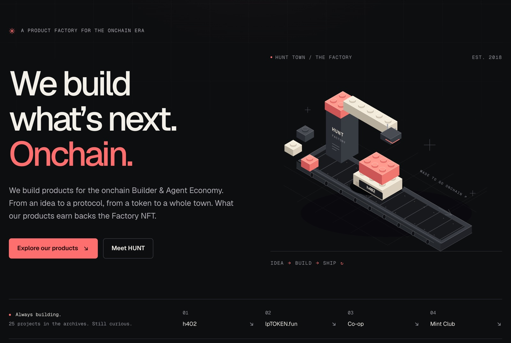
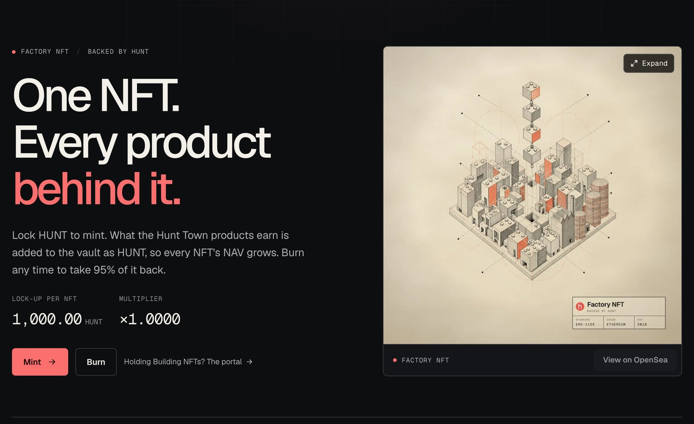

# Introduction

**Hunt Town is an Onchain Product Factory.** We have built onchain products since 2018, and
each one hands what it learned to the next. What our products earn backs one asset, the
Factory NFT, counted in HUNT.

<figure><figcaption>
hunt.town
</figcaption></figure>

## Start here

- **[The Factory Model](hunt-town/factory-model.md):** how we build, ship and archive
  products, and who we build them for.
- **[Factory NFT](factory-nft/overview.md):** the HUNT-backed NFT that our products' revenue
  backs. Mint at the NAV per NFT, burn any time for 95% of it.
- **[HUNT](hunt/hunt-erc20.md):** the token under the economy. Issued once, and about 60% of
  it has been burned since.
- **Products:** [Aeromax.fun](aeromax/overview.md), [h402](h402/overview.md),
  [lpTOKEN.fun](lptoken/overview.md), [Co-op](co-op/overview.md) and
  [Mint Club](mint-club/overview.md). The current lineup is on
  [hunt.town](https://hunt.town/#now).
- **[Archives](track-record/build-log.md):** the 25 products we shipped before.

<figure><figcaption>
The Factory NFT on hunt.town
</figcaption></figure>
