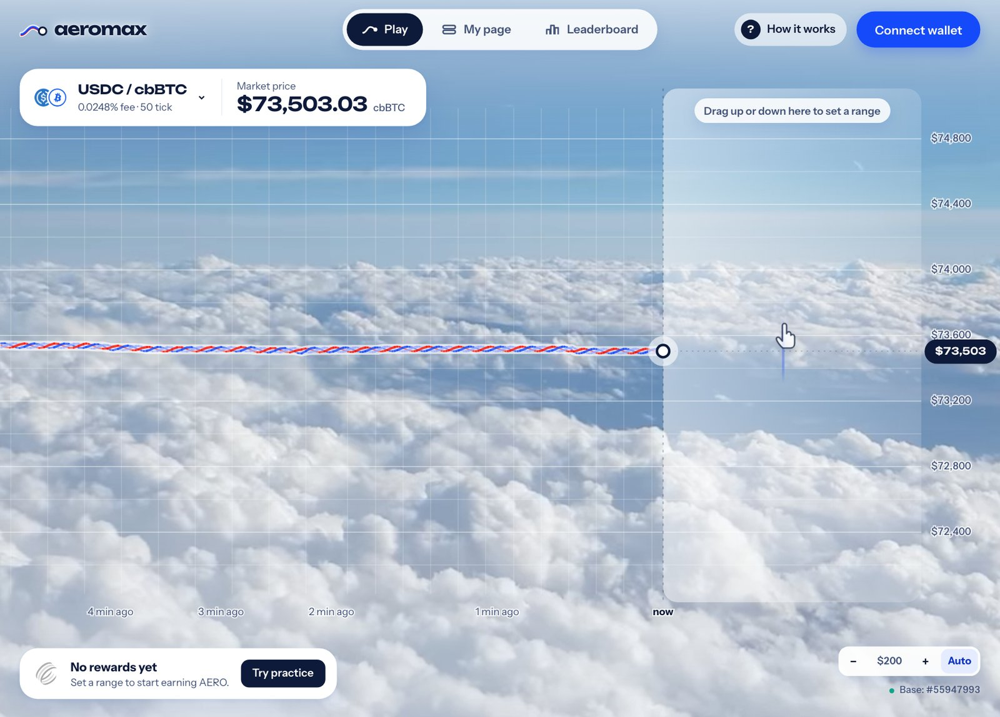
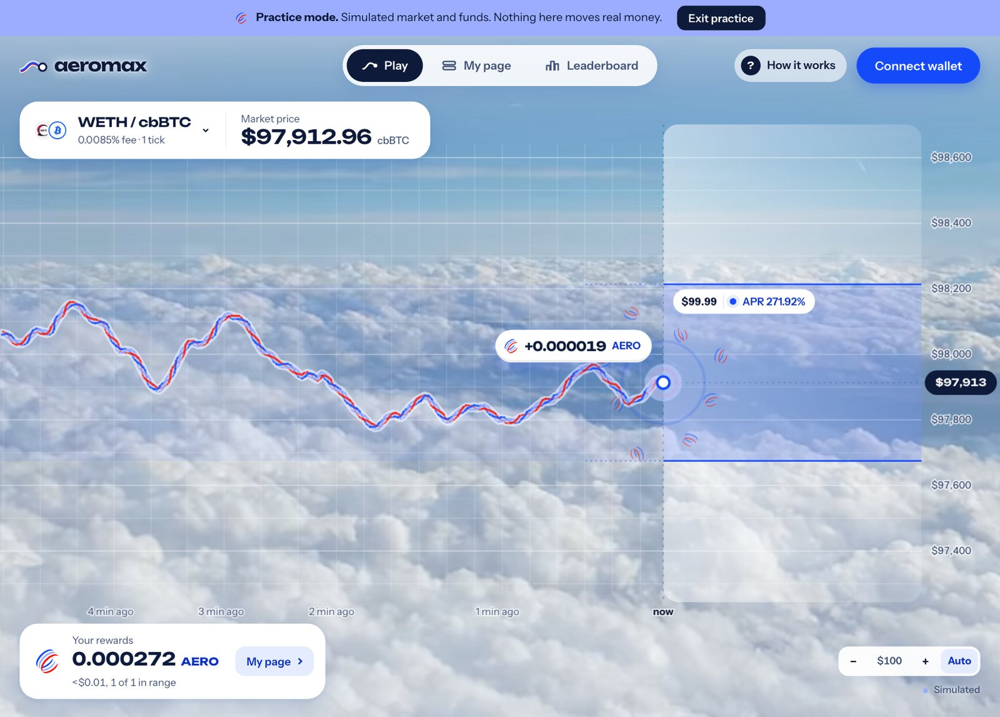

# Aeromax.fun: Overview

**Yield maxing for Aerodrome LPs.**

Aeromax.fun is a concentrated-liquidity terminal for **Aerodrome on Base**. You set a price
range by dragging on a live chart, the position is staked for **AERO**, and the rewards land
on the chart while the price stays in your range.

<figure><figcaption>
Play: the live price of an Aerodrome pool, with the range zone beside it
</figcaption></figure>

## The idea

Concentrated liquidity earns only while the price sits inside your range, and nothing once it
leaves. That makes it one of DeFi's most rewarding positions and one of its hardest to
manage: pick a range, size it, stake it, watch it, and move it when the price moves.

Aeromax.fun puts all of that on one live chart. The range is something you drag, the APR is
shown before you deposit, and the AERO you earn appears where the price is.

## What you can do

- **Watch a pool live.** The chart draws the pool's price as it trades. The pool picker
  finds Aerodrome's current concentrated-liquidity pools on Base, ranked by recent swaps.
- **Set a range with one drag.** Drag up or down beside the price. You see the range and its
  AERO APR before you deposit. See [Ranges & AERO Rewards](ranges-and-rewards.md).
- **Stake for AERO.** New positions are staked in Aerodrome's gauge and earn AERO emissions
  while the price is in range.
- **Follow your ranges.** My page lists every range with its value, uncollected AERO, and
  Collect and Exit actions.
- **Compete.** The leaderboard ranks wallets by the AERO they collected from ranges opened
  through Aeromax.fun.
- **Practice first.** Practice mode runs a simulated market with simulated funds, so anyone
  can try the whole flow without a wallet. Nothing in it moves real money.

<figure><figcaption>
A range earning AERO, shown in Practice mode
</figcaption></figure>

## Where it runs

Aeromax.fun is in **beta** at [aeromax.fun](https://aeromax.fun), on **Base**, for
Aerodrome's concentrated-liquidity pools. It needs no account: connect a Base wallet, or open
Practice mode from **How it works** or **My page**.

Fees, custody and the risks to know are in [Fees & Risks](fees-and-risks.md).
