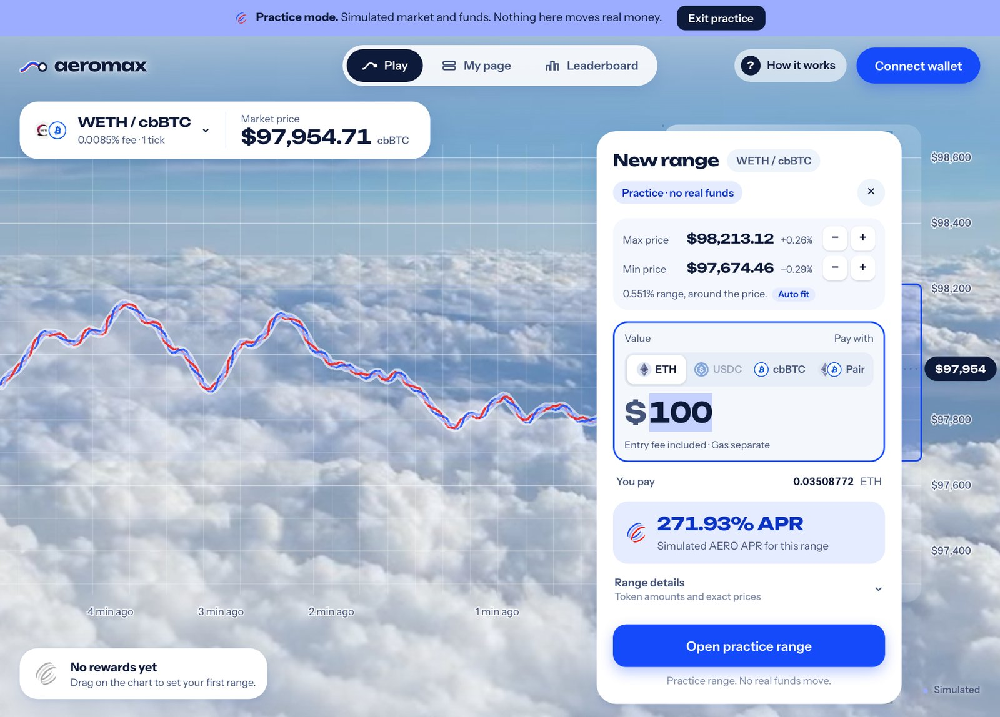
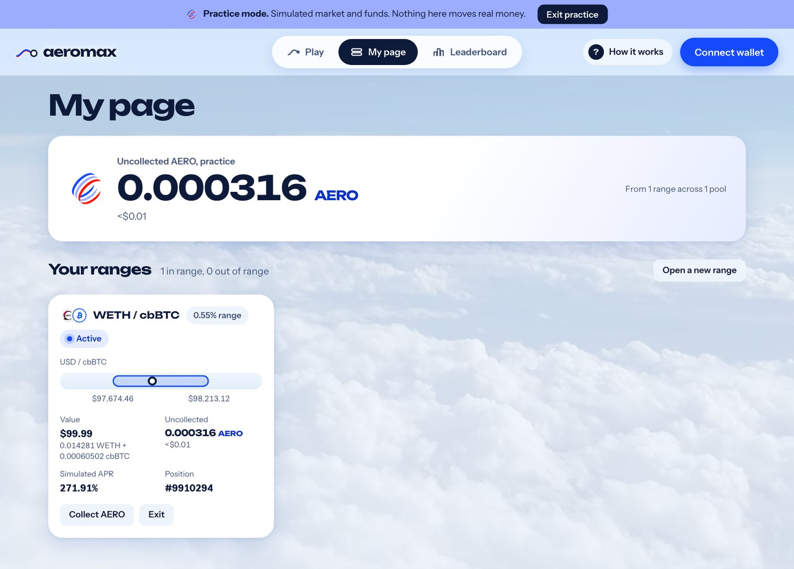
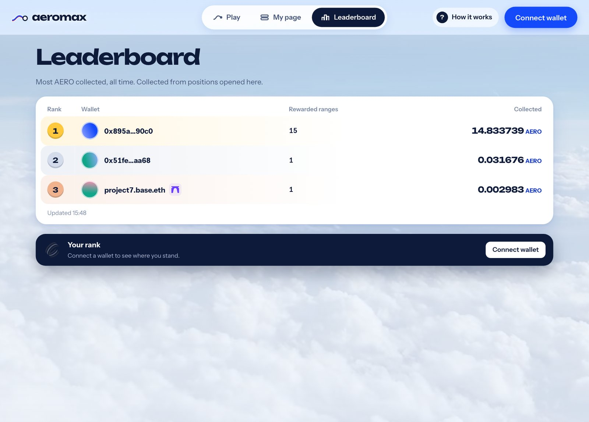

# Ranges & AERO Rewards

## Reading the chart

- **The price line.** The braided line is the pool's live price. Every swap moves it, and
  each swap rings once at the head of the line. The chart shows the last five minutes, with
  **now** at the head.
- **The range zone.** The area right of **now** is where you set ranges. Pointing at it
  previews a range and its AERO APR.
- **Prices in USD.** Prices are shown in approximate USD first. The pool's own token ratio is
  still used for every transaction.
- **The sky.** The weather follows the selected pool's own price. Clouds and rain gather on a
  fall, warm light appears on a rise, and a sharp move brings turbulence. A chip beside the
  pool states the move behind the weather. It reads no extra data.

## Setting a range

1. **Drag beside the price.** Drag up or down in the range zone. The range grows in whole
   steps of the pool's tick spacing.
2. **Check the card.** Releasing opens the **New range** card next to the range: the max and
   min prices with fine steps and **Auto fit**, the value to deposit, what you pay with, and
   the range's AERO APR.
3. **Pay with one token or the pair.** Pay with a single token, such as ETH or USDC, or with
   both sides of the pool. With one token, the deposit is split to fit the range at the
   quoted price after the swap, not 50/50. A pair deposit refunds what the range does not use.
4. **Open the range.** Confirm in your wallet. Approvals can add confirmations.

<figure><figcaption>
The New range card, shown in Practice mode
</figcaption></figure>

Narrow ranges show a higher APR, but the price leaves them sooner.

## While you earn

- **In range.** The range is drawn in AERO blue and its label shows the live AERO APR. When
  new AERO arrives, it appears on the chart and the rewards total ticks up.
- **Out of range.** The range turns red and earns nothing until the price comes back. Its
  label offers **Exit**.
- **The APR is an estimate.** It comes from the gauge's current emissions and the staked
  liquidity in range, after any referral share the gauge sets. It does not include the
  dilution your own deposit adds or early-claim penalties.

## Collecting and exiting

My page lists every range with its current assets, value, uncollected AERO, LP fee balance,
and when its AERO unlocks.

<figure><figcaption>
My page, shown in Practice mode
</figcaption></figure>

- **Collect AERO.** Collect once the gauge's unlock period has passed. Earlier claims are
  blocked.
- **Exit.** Take your principal back as either token or as the pair. LP fees and AERO are
  paid out separately. Exiting before the unlock forfeits part of the accrued AERO under the
  gauge's rules, and the app asks you to accept that first.

## The leaderboard

The leaderboard ranks wallets by the **AERO actually collected** from ranges opened through
Aeromax.fun, all time. Principal and LP fees do not count. It shows the top 50 wallets and,
when you connect, your own rank.

<figure><figcaption>
The leaderboard
</figcaption></figure>
