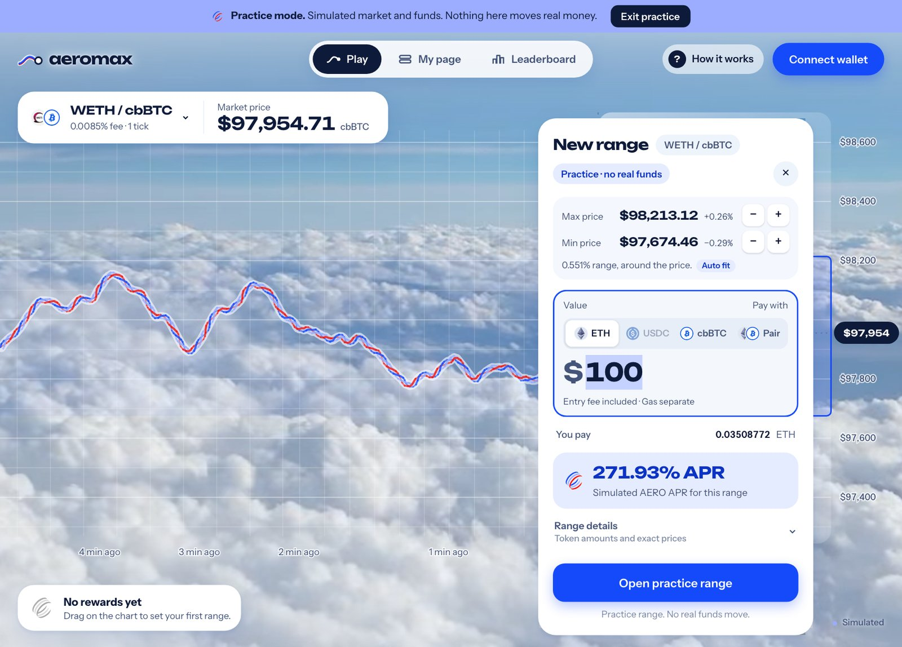
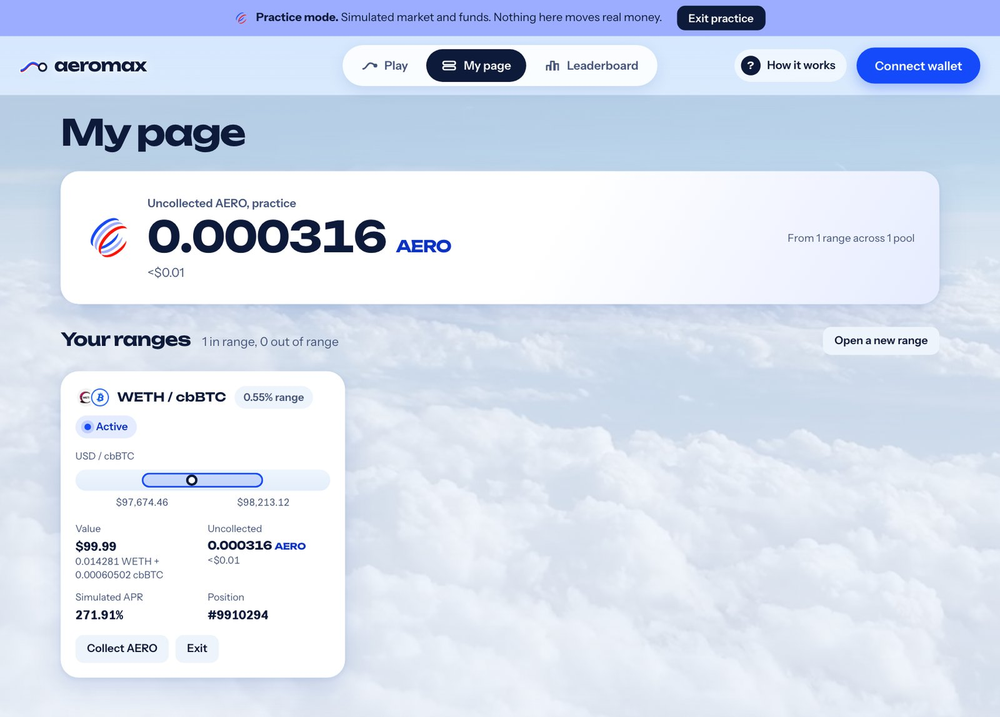
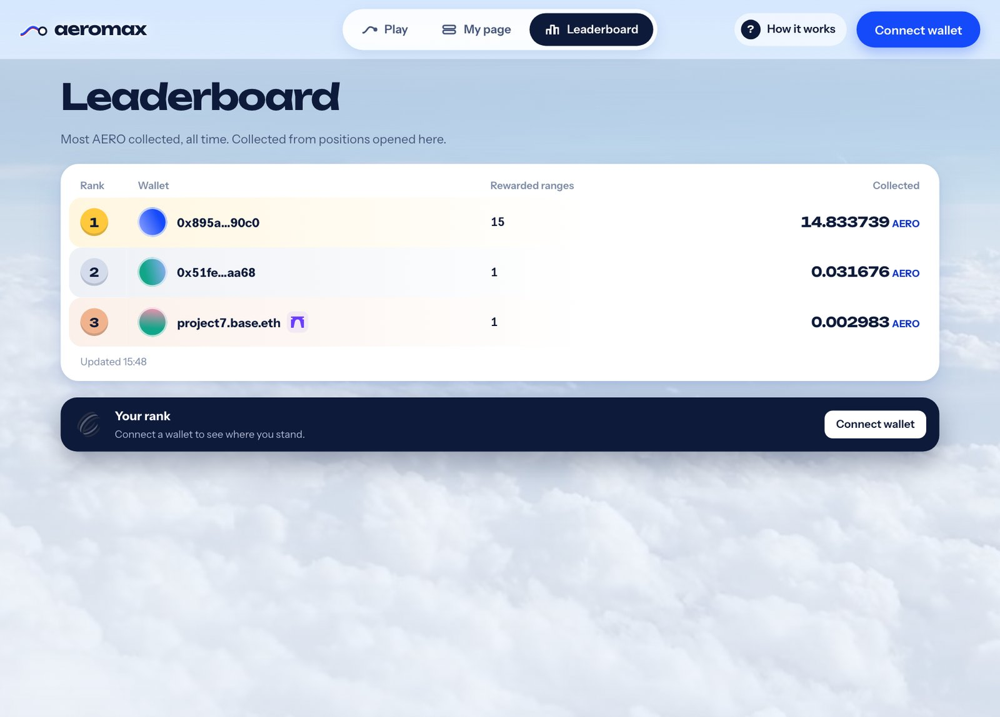

# Ranges & AERO Rewards

## Reading the chart

- **The price line** is the pool's live price. Every swap moves it.
- **The range zone** is the area right of **now**, where you set ranges. Pointing at it
  previews a range and its AERO APR.
- **Prices are shown in approximate USD.** Transactions still use the pool's own token ratio.

## Setting a range

1. **Drag beside the price.** Drag up or down in the range zone. The range grows in whole
   steps of the pool's tick spacing.
2. **Check the card.** Releasing opens the **New range** card: the price range, the value to
   deposit, what you pay with, and the range's AERO APR.
3. **Pay with one token or the pair.** With one token, the deposit is split to fit the range.
   A pair deposit refunds what the range does not use.
4. **Open the range.** Confirm in your wallet. Approvals can add confirmations.

<figure><figcaption>
The New range card, shown in Practice mode
</figcaption></figure>

Narrow ranges show a higher APR, but the price leaves them sooner.

## While you earn

- **In range.** The range's label shows its live AERO APR, and new AERO appears on the chart
  as it arrives.
- **Out of range.** The range earns nothing until the price comes back, and its label offers
  **Exit**.
- **The APR is an estimate.** It comes from the gauge's current emissions and the staked
  liquidity in range, after any referral share the gauge sets. It does not include the
  dilution your own deposit adds or early-claim penalties.

## Collecting and exiting

My page lists every range with its current assets, value, uncollected AERO, LP fee balance,
and when its AERO unlocks.

<figure><figcaption>
My page, shown in Practice mode
</figcaption></figure>

- **Collect AERO.** Collect once the gauge's unlock period has passed. Earlier claims are
  blocked.
- **Exit.** Take your principal back as either token or as the pair. LP fees and AERO are
  paid out separately. Exiting before the unlock forfeits part of the accrued AERO under the
  gauge's rules, and the app asks you to accept that first.

## The leaderboard

The leaderboard ranks wallets by the **AERO actually collected** from ranges opened through
Aeromax.fun, all time. Principal and LP fees do not count. When you connect, it also shows
your own rank.

<figure><figcaption>
The leaderboard
</figcaption></figure>
