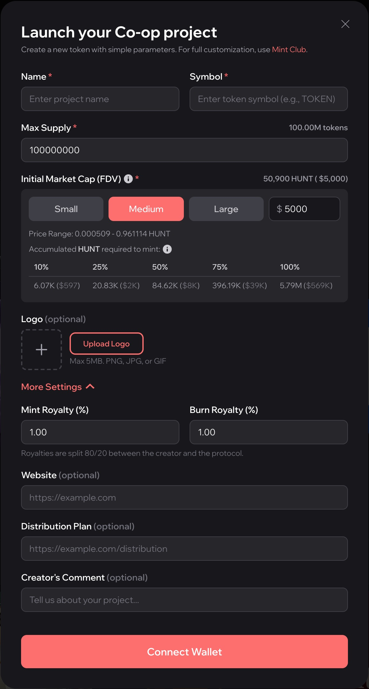

# Launch a Project Token

A builder launches a project token on the Co-op with a few settings. The Co-op fixes the
curve and the reserve. For full control over both, a builder can launch on
[Mint Club](../mint-club/overview.md) directly.

<figure><figcaption>
The launch form on coop.hunt.town
</figcaption></figure>

## What the builder sets

| Setting | What it does |
| --- | --- |
| **Name and symbol** | The symbol must not be taken already. |
| **Maximum supply** | Fixed at launch. |
| **Starting market value** | The fully diluted value at the first price, in dollars. It is converted to HUNT at launch. |
| **Royalties** | A mint royalty and a burn royalty, paid in HUNT. |
| **Project details** | Optional logo, website, distribution plan and a comment from the builder. |

## What the Co-op fixes

- **One preset curve.** Every Co-op token uses the same bonding curve. The price rises with
  supply and climbs steeply toward the maximum.
- **HUNT as the reserve.** Every token's reserve is HUNT on Base.
- **No free allocation.** The curve starts at a price, so the builder buys like anyone else.

## What it costs

Launching costs Mint Club's creation fee and gas, paid in ETH on Base. No HUNT is needed to
launch, and there is no required first buy.

## What the builder gets

- **Royalties on every trade,** paid in HUNT and shared with the Mint Club protocol.
- **A project page** on the Co-op. Its details are stored as Mint Club token metadata, so
  they show on mint.club as well.
- **Mint Club's creator tools** for the token, such as lock-ups and bulk sends.

The symbol and the maximum supply cannot change after launch.
