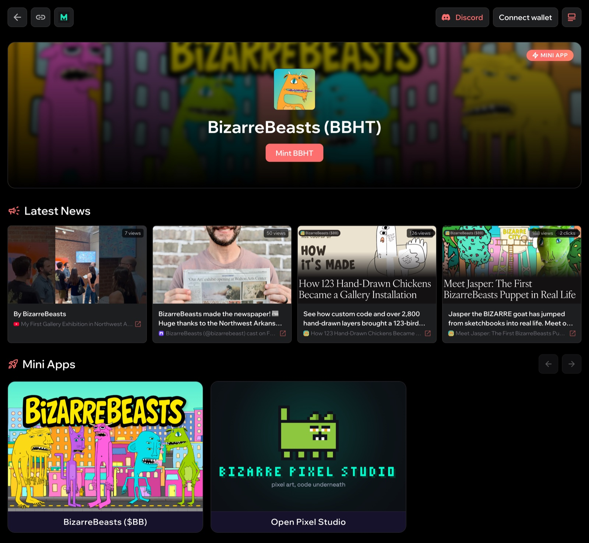

# Co-op: Overview

**Co-op is a HUNT-backed launchpad and DEX at [coop.hunt.town](https://coop.hunt.town).**
Builders launch project tokens on bonding curves with HUNT as the reserve, and anyone can buy
or sell them against HUNT from the moment they launch. Co-op runs on the
[Mint Club](../mint-club/overview.md) protocol on Base.

## How it works

```
   Builders ──launch──▶  HUNT-backed project tokens  ◀──buy / sell──  Anyone
                                  │
            each token keeps its own reserve, always in HUNT
```

- **Launch.** A builder creates a project token with a few settings. It trades from the
  moment it launches, with no liquidity pool to seed and no listing to wait for. See
  [Launch a Project Token](launch-a-project-token.md).
- **Trade.** Buying mints the token on its curve and locks HUNT in its reserve. Selling burns
  the token and returns HUNT from that reserve. See [Trading & the HUNT Reserve](trading.md).
- **One reserve asset.** Every project keeps its own reserve, and every reserve is HUNT. See
  [HUNT as the Reserve Token](../hunt/reserve-token.md).

## What's on the Co-op

- **A directory** of every token on Base that uses HUNT as its reserve, whether it was
  launched on the Co-op or on Mint Club.
- **Project pages** with the builder's comment, links, distribution plan and live stats.
- **Project updates** that builders post for their community. Each update burns a small amount
  of HUNT.
- **Mini Apps** that a project can list on its page.

<figure><figcaption><p>An example project page with its Latest News (project updates) and Mini Apps</p></figcaption></figure>

Co-op launched on December 3, 2025, after Clap ended.
