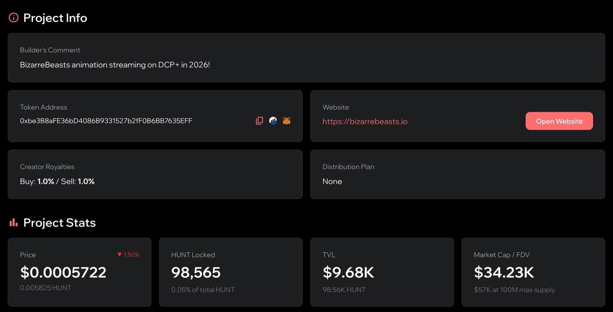

# Trading & the HUNT Reserve

Co-op tokens trade against their own bonding curves, not an order book or a liquidity pool.
Every trade moves HUNT into or out of the token's reserve.

## Buying and selling

- **Buying** mints new tokens along the curve. The HUNT goes into that token's reserve, and
  the price moves up the curve. A buyer can also pay with another token; it is swapped to HUNT
  first, so every buy reaches the reserve as HUNT.
- **Selling** burns tokens back to the curve. HUNT comes out of the reserve, less any burn
  royalty, and the price moves down.
- **Where trades happen.** On the Co-op, and on [mint.club](https://mint.club) against the
  same curve, because every Co-op token is a Mint Club token.

## Royalties

The mint royalty is paid on top of the reserve deposit. The burn royalty comes out of what a
seller receives. Both are paid in HUNT and shared between the creator and the Mint Club
protocol. Each project page shows its rates.

## Many reserves, one asset

Each token keeps its own reserve, held by the Mint Club V2 contract on Base, and each reserve
backs only its own token. HUNT held in these reserves counts as locked in
[Supply & Distribution](../hunt/supply.md). It returns to circulation when holders sell.

<figure><figcaption>
Project stats show the price in dollars and in HUNT, and the HUNT locked in the reserve. Example project, figures at capture time.
</figcaption></figure>
