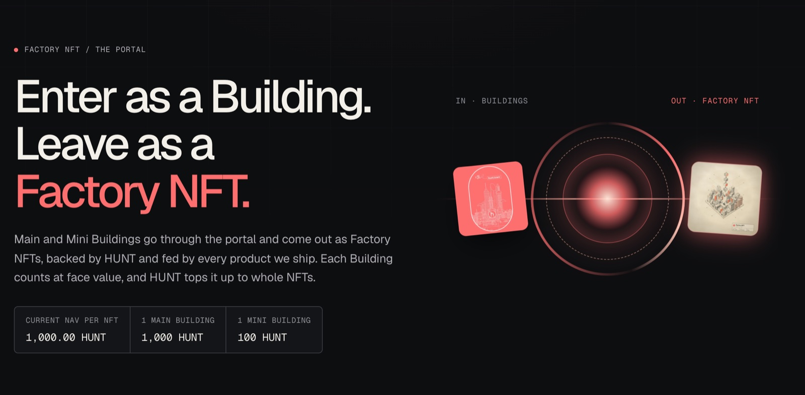
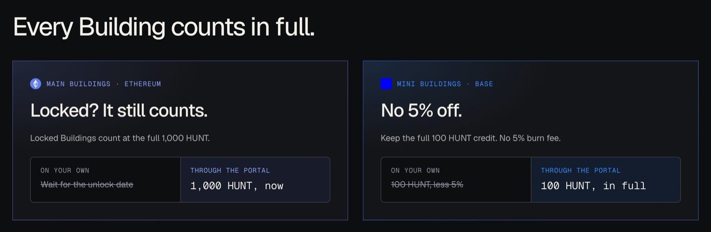
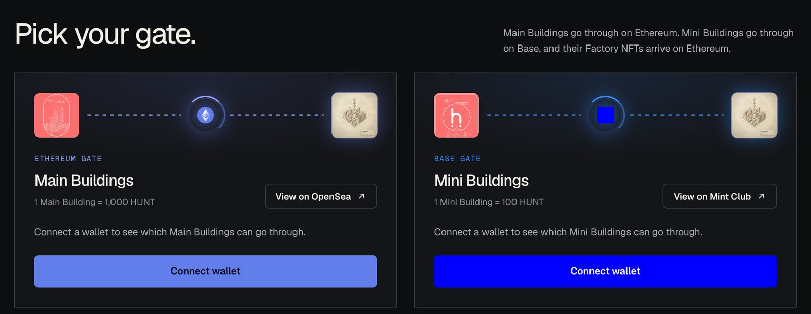

# Migrating Buildings

Building NFTs are Hunt Town's legacy NFTs. Holders can turn them into Factory NFTs. Each
Building counts at a fixed HUNT value, and you add HUNT to reach whole Factory NFTs.

**Migration support ends on November 30, 2026.**

<figure><figcaption>
The migration portal
</figcaption></figure>

## The rules

- **One way.** Migrated Buildings do not come back.
- **One chain at a time.** Main Buildings migrate on Ethereum in one transaction. Mini
  Buildings and their top-up are sent on Base.
- **Whole NFTs only.** There are no partial Factory NFTs and no refunds.
- **Factory NFTs arrive on Ethereum,** whichever chain you migrate from. From Base, the team
  confirms the deposit and then mints them to the same wallet address on Ethereum. You pay gas
  on Base only.
- **Same address on Ethereum.** Before a Base deposit, confirm that you control the same
  address on Ethereum. This matters most for smart contract wallets, whose address can differ
  between chains.

| | Main Building | Mini Building |
| --- | --- | --- |
| **Network** | Ethereum | Base |
| **Counts as** | 1,000 HUNT each | 100 HUNT each |
| **Top-up paid in** | HUNT on Ethereum | HUNT on Base |

## Counted in full

Through November 30, 2026, each Building counts at the full HUNT it was minted with:

- **Locked Main Buildings count.** Main Buildings still locked in the Town Hall are accepted
  at the full 1,000 HUNT, without waiting for the unlock date.
- **No 5% off Mini Buildings.** The 5% burn fee that applies when a Mini Building is burned
  on Mint Club is waived.

<figure><figcaption>
Every Building counts in full
</figcaption></figure>

## How many Factory NFTs

The Buildings' HUNT value is divided by the current NAV per NFT and rounded up to whole
Factory NFTs. The holder adds the difference in HUNT (the top-up), which is never refunded.
You review a quote before you send anything.

- **Main Buildings** use the NAV when the transaction runs, within the HUNT limit you set.
- **Mini Buildings** are quoted when you deposit. The confirmed deposit fixes the number of
  Factory NFTs and the top-up, even if the NAV moves before delivery.

At a NAV of 1,000 HUNT per NFT, one Main Building or ten Mini Buildings make one Factory NFT
with no top-up.

Migrate at [hunt.town/migrate](https://hunt.town/migrate).

<figure><figcaption>
One gate per chain
</figcaption></figure>

## Where the HUNT comes from

Migration does not burn Buildings or take out the HUNT behind them. The team funds the
migration with HUNT, and the new Factory NFTs are minted from that HUNT at the full current
NAV, like any other mint.

## Legacy Buildings

- A **Main Building** (Ethereum, ERC-721) was minted with 1,000 HUNT through the Town Hall
  contract, which holds that HUNT until the Building unlocks and is burned.
- A **Mini Building** (Base, ERC-1155) was minted with 100 HUNT on Mint Club, whose reserve
  holds that HUNT.

Addresses are in [Contracts & Addresses](../reference/contracts.md), and the audit of the
Town Hall and Building contracts is in
[Links & Resources](../reference/links.md#security-and-audits).
