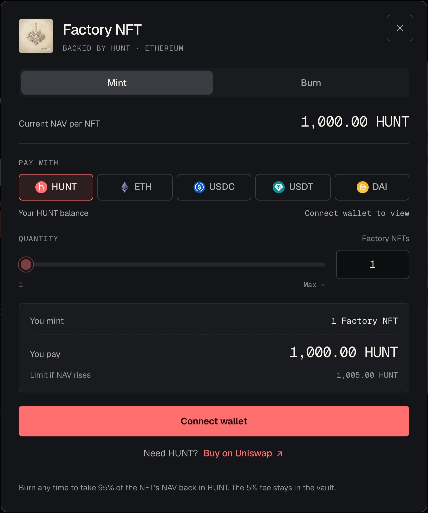
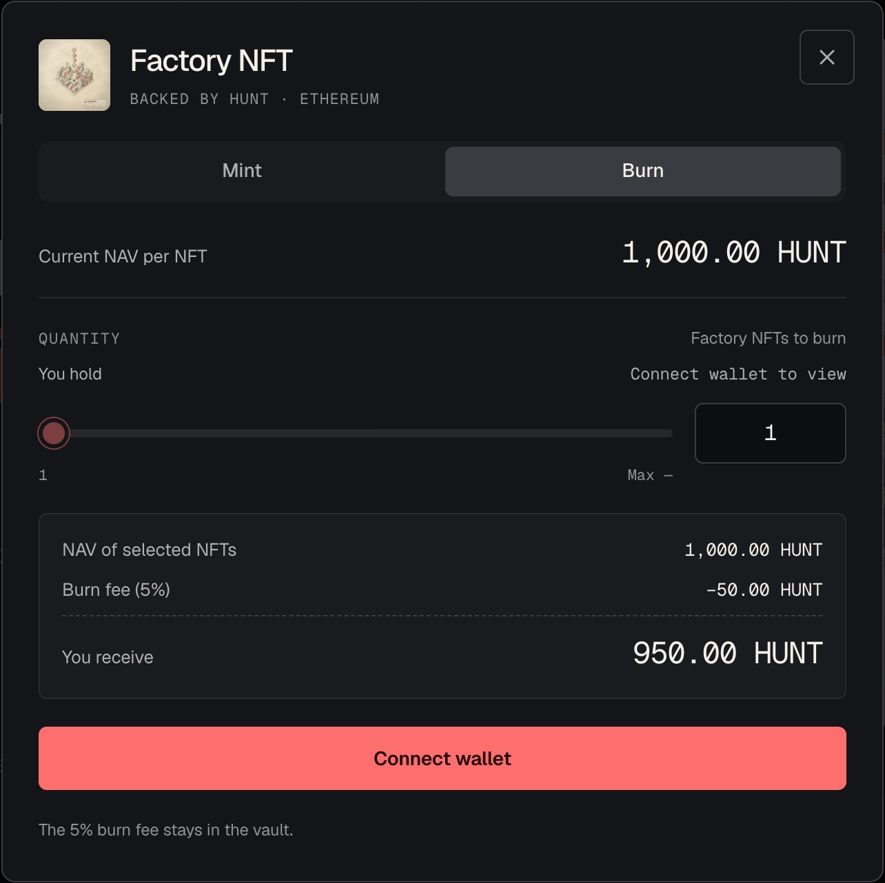

# Mint & Burn

Factory NFTs are minted and burned against the HUNT in the vault, at the NAV per NFT. There
is no bonding curve and no order book.

## Mint

```
HUNT to mint q NFTs = HUNT in the vault × q ÷ NFTs in supply
```

- **All of it goes into the vault.** The HUNT you lock stays in the Factory NFT contract.
- **Existing holders are not diluted.** New NFTs bring in their full share of HUNT, so the
  NAV per NFT does not drop.
- **Pay with HUNT,** or with another token swapped to HUNT in the same transaction.

<figure><figcaption><p>Minting on hunt.town</p></figcaption></figure>

## Burn

```
HUNT you receive = HUNT in the vault × q ÷ NFTs in supply × 95%
```

- **The burn fee is 5%.** It stays in the vault for everyone still holding.
- **Only the holder can burn.** A burn takes NFTs from the burner's own wallet.
- **The last NFT stays.** Supply can never drop below one.

<figure><figcaption><p>Burning on hunt.town</p></figcaption></figure>

## A worked example

At launch the vault held 1,000 HUNT behind the one seed NFT.

1. Someone mints one NFT and locks 1,000 HUNT. The vault holds 2,000 HUNT behind two NFTs,
   still 1,000 HUNT each.
2. They burn it straight away and receive 950 HUNT. The 50 HUNT fee stays behind.
3. The vault holds 1,050 HUNT behind one NFT, so the NAV per NFT is 1,050 HUNT.

## What you get back in HUNT

```
HUNT back ÷ HUNT locked = 0.95 × NAV per NFT at burn ÷ NAV per NFT at mint
```

- Burn at the NAV you minted at, and you get back 95% of the HUNT you locked.
- You get back more HUNT than you locked only after the NAV per NFT has risen more than
  about 5.26% since your mint.

Everything here is counted in HUNT, whose price can fall. See
[The NAV Vault](nav-vault.md) and [Terms](../terms.md).
