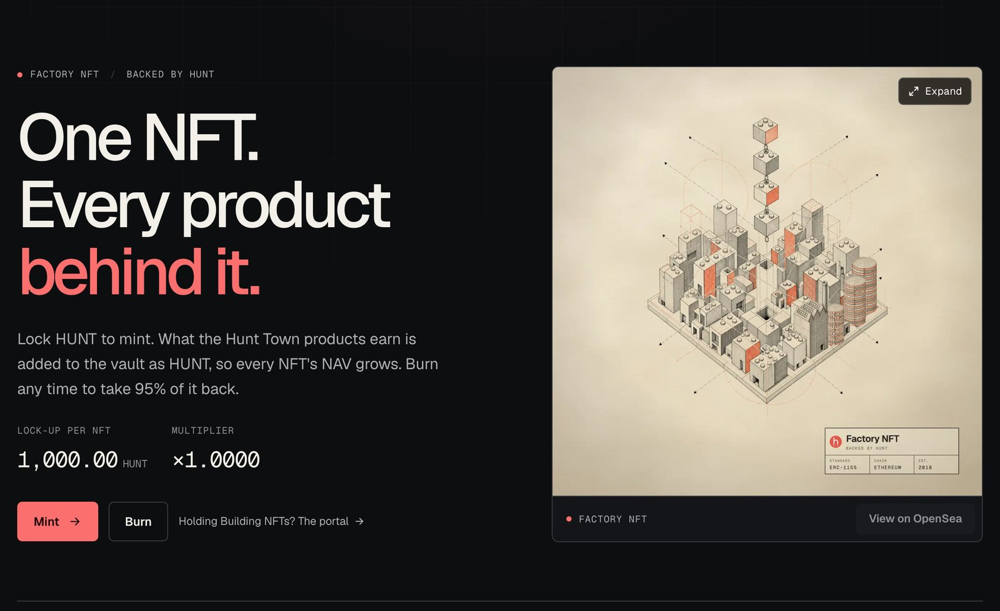
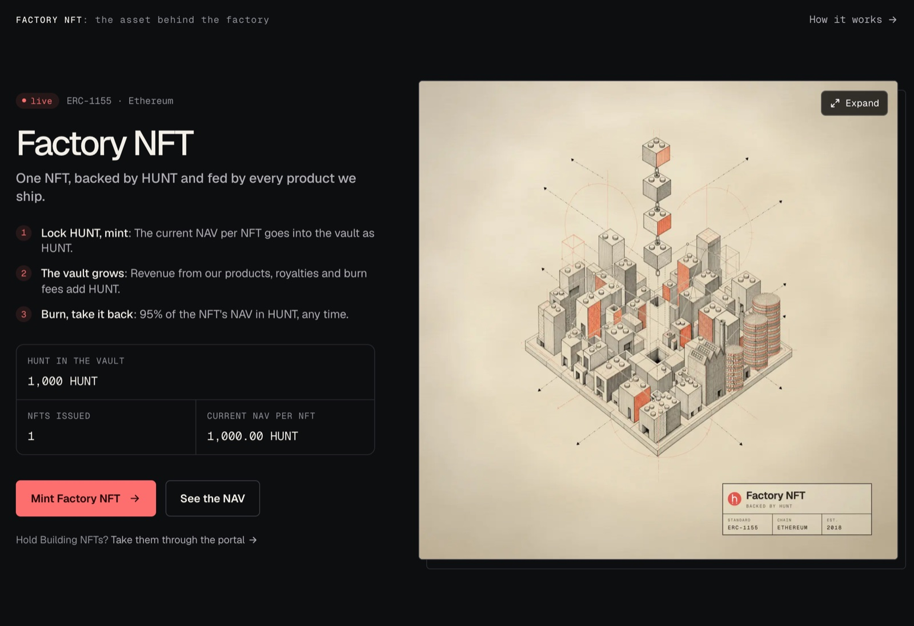

# Factory NFT: Overview

**The Factory NFT is the one asset that product revenue backs.** You lock HUNT to mint one.
Product revenue, marketplace royalties and donations add more HUNT to the vault, which raises
the NAV of every NFT at once. Burn any time to take 95% of your NFT's NAV back in HUNT.

<figure><figcaption>
The Factory NFT on hunt.town
</figcaption></figure>

## At a glance

| | |
| --- | --- |
| **Network** | Ethereum mainnet |
| **Standard** | ERC-1155, token id `0` |
| **Supply** | Unlimited. Minted at NAV, burned for 95% of NAV |
| **NAV per NFT** | The vault's HUNT divided by the number of NFTs. 1,000 HUNT at launch |
| **Pay with** | HUNT, or another token swapped to HUNT in the same transaction |
| **Backed by** | HUNT, held by the Factory NFT contract itself |
| **Minimum supply** | One. The last NFT cannot be burned |
| **Burn fee** | 5%, stays in the vault |
| **Marketplace royalty** | 3% (ERC-2981), paid by marketplaces that honor it |
| **Upgradeable** | No |
| **Contract** | `0x961eA6C51c185958b1A11ad8335046988D1B5734` · [Etherscan](https://etherscan.io/token/0x961eA6C51c185958b1A11ad8335046988D1B5734) · [OpenSea](https://opensea.io/item/ethereum/0x961eA6C51c185958b1A11ad8335046988D1B5734/0) |

## How it works

1. **Mint at NAV.** Anyone can mint by locking the current NAV per NFT in HUNT.
2. **The vault grows.** HUNT added outside a mint raises the NAV per NFT for every holder at
   once. See [The NAV Vault](nav-vault.md).
3. **Burn for HUNT.** A burn returns 95% of the NFT's NAV in HUNT. The other 5% stays in the
   vault. See [Mint & Burn](mint-and-burn.md).

<figure><figcaption>
The Factory NFT on the hunt.town home page
</figcaption></figure>

## What the owner cannot do

The owner cannot withdraw the vault's HUNT, mint NFTs without HUNT behind them, or upgrade
the contract. See [Safeguards](nav-vault.md#safeguards).

## Where to use it

- Mint, burn, donate and live figures: [hunt.town/factory](https://hunt.town/factory).
- Your holdings and history: [hunt.town/my-factories](https://hunt.town/my-factories).
- Donations and their messages: [hunt.town/donors](https://hunt.town/donors).
