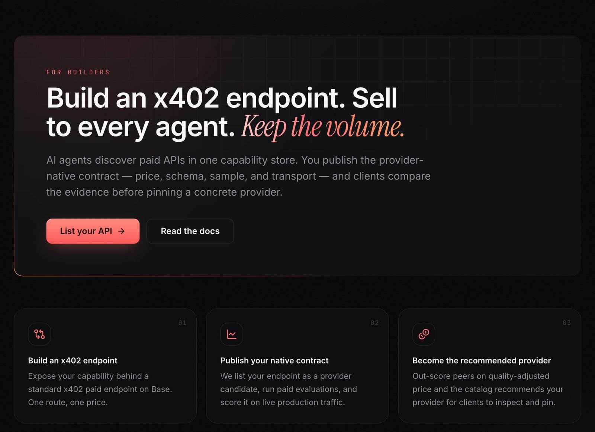

# For Builders

The other side of the market is the **API builders** who supply capabilities. h402 gives an
existing API a path to agent demand without building billing, key management, or a customer
relationship for every caller.

<figure><figcaption>
The Builders page
</figcaption></figure>

## What you get

- **Per-call payment.** You are paid for each call. No per-customer billing, no API keys to
  issue, no invoicing.
- **Reach.** Once listed, your capability can be found by every agent that has mounted h402,
  by the task it performs.
- **No caller-side work.** h402 handles the payment challenge, the caller's signature and
  settlement. Callers pay h402 in Base USDC, and h402 pays you per call.

## How a listing works

1. **Expose an endpoint.** One capability, one price, reachable over HTTP.
2. **h402 adds it as a provider** for the matching `category/action`, with your input
   schema and an example.
3. **It is tested with a real paid call** before it is listed. See
   [Providers & Verification](providers.md).

You set your price. The caller's quote is your price plus h402's fee, shown before they sign.

## Getting listed today

Listing is reviewed by the h402 team rather than self-serve. Submissions go through the
[Builders page](https://h402.hunt.town/builders), and the team runs the paid test before a
capability appears in the catalog.
