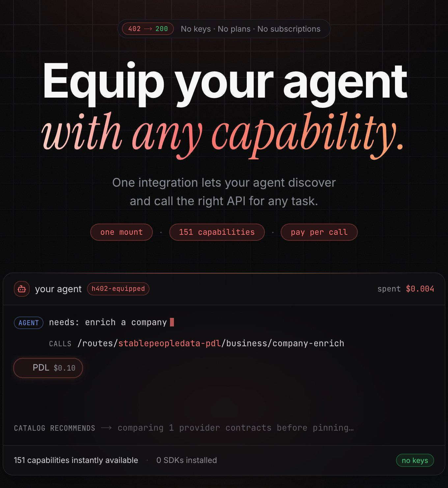
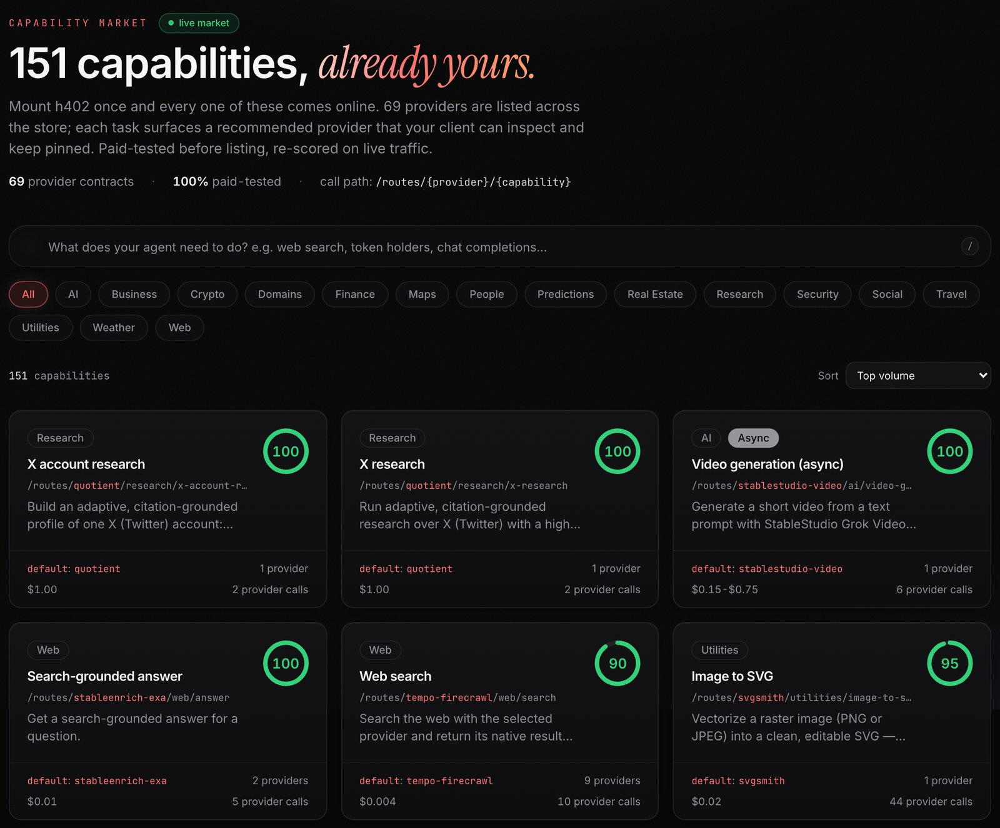

# h402: Overview

**h402 is the Agent Capability Market Layer: the x402 capability store for agents.**
Mount it once, and an agent can discover, inspect, and pay for a whole market of
capabilities, such as web research, onchain data, AI generation and maps, without setting up
each API separately.

<figure><figcaption>
The h402 home page
</figcaption></figure>

## The problem

An agent that needs ten services today needs ten integrations: ten API keys, ten billing
relationships and ten SDKs. h402 replaces that with **one integration and one way to pay**.

## Three ideas

- **Mount once.** The agent reads one skill file, which teaches it to search the catalog,
  pick a provider and pay. New capabilities need nothing new to install.
- **Verified providers, explicit choice.** Every listed provider has passed a real paid test,
  and its real response is stored as a sample. The caller compares samples and prices, then
  **pins** the provider it wants. See [Providers & Verification](providers.md).
- **Pay per call.** Paid capabilities settle in **Base USDC** over **x402**, signed locally by
  the caller's wallet. No API keys per provider, no subscriptions, no custody. See
  [How Paying Works](how-paying-works.md).

A **capability** is a task, named `category/action` (for example `web/search`). A
**provider** is one implementation of it, with its own price and sample.

<figure><figcaption>
The capability catalog
</figcaption></figure>

## Two sides of the market

- **For agents and apps:** mount the skill, search the catalog, call what you need, pay per
  call. Callers use the open-source `@h402/cli`, or embed payments in their own app with
  `@h402/core`.
- **For API builders:** list a capability and reach agent demand without building billing.
  See [For Builders](for-builders.md).

## Status

h402 is **live in beta** at [h402.hunt.town](https://h402.hunt.town), so details can change.
The live catalog is at [h402.hunt.town/catalog](https://h402.hunt.town/catalog), and
developer docs at [h402.hunt.town/docs](https://h402.hunt.town/docs).
