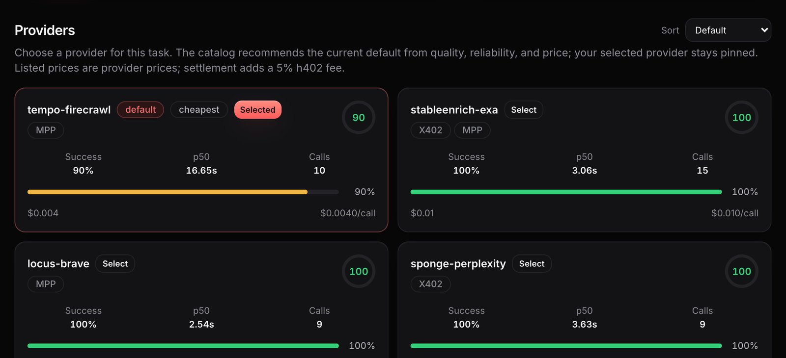

# Providers & Verification

A **capability** is a task. A **provider** is one concrete implementation of it. Before you
pay, the catalog shows each provider's price, its input schema and a sample of a real paid
response, so you can predict the cost and the shape of the result.

<figure><figcaption>
Providers of one capability, compared side by side
</figcaption></figure>

## Selection is explicit

**Every call is pinned to one provider.** The caller (a person, an agent, or the CLI on the
agent's behalf) chooses the provider before the call. h402 does not route a request to a
different provider. Each response records which provider served it, so every call can be
audited afterwards.

The catalog recommends a default provider for each capability. It is a suggestion the caller
can pin, not a router.

## Verification

- A provider is listed only after a **real, paid test call** against its live endpoint.
- The **response** from that call is stored as the provider's **sample**. This is the "real
  sample" the catalog shows.
- A provider that fails its test is taken out of the catalog.
