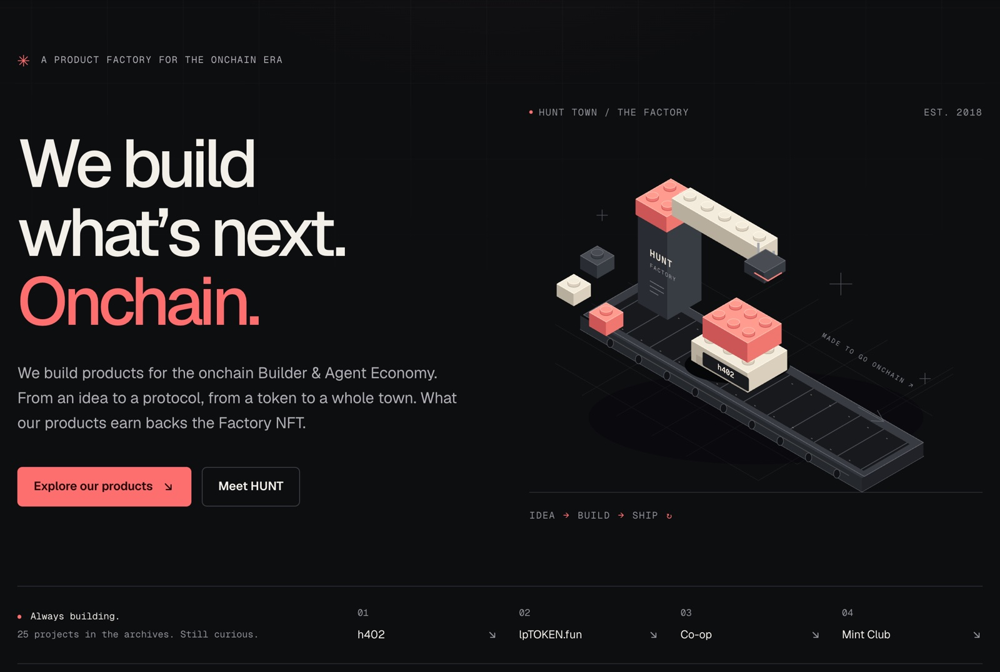
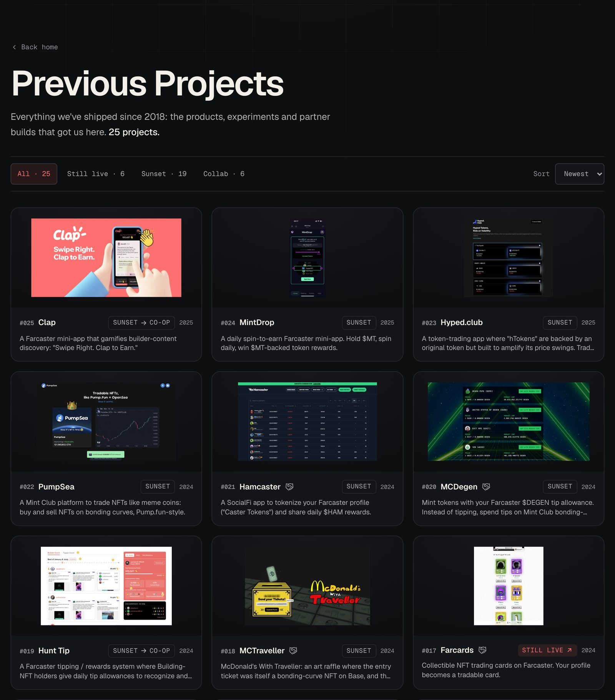

# The Factory Model

Hunt Town is an **Onchain Product Factory**. We build, ship and run many onchain products
over time instead of maintaining one app forever. The products share one economy, and what
they earn backs one asset: the [Factory NFT](../factory-nft/overview.md).

<figure><figcaption>
hunt.town
</figcaption></figure>

## Build → ship → seed

1. **Build:** take an onchain primitive (curation rewards, bonding curves, NFT ownership,
   liquidity positions, agent payments) and turn it into a product people use.
2. **Ship:** launch it and run it for as long as it serves the ecosystem.
3. **Seed:** when it retires, its mechanics, community and lessons seed the next product.

The [Archives](../track-record/build-log.md) record what each product seeded. Steemhunt's
reward curation seeded everything. Neverlose.money's lock-ups fed Mint Club's tools. Hunt
Tip's tipping seeded the Co-op.

We archive fast. A product that does not work out, or leaves our main focus, is archived so
the team's time goes to new products.

<figure><figcaption>
The Archives on hunt.town
</figcaption></figure>

## Who we build for

We build for the onchain **Builder & Agent Economy**.

- **Builders** launch tokens and projects, and most start alone. Our projects share one
  reserve asset, HUNT, so they are linked instead of competing for it. See
  [HUNT as the Reserve Token](../hunt/reserve-token.md).
- **Agents** are software that does economic work, such as calling APIs or buying data.
  They need to pay per use without a person or an account behind every vendor. See
  [h402](../h402/overview.md).
- **Holders** buy, trade and hold what builders launch, and can hold the Factory NFT.

## The shared foundation

New products use the parts that already exist:

- **[The Factory NFT](../factory-nft/overview.md):** product revenue buys HUNT for its vault.
- **[HUNT](../hunt/hunt-erc20.md):** the token that revenue buys, and the reserve behind
  HUNT-backed tokens.
- **[Mint Club](../mint-club/overview.md):** the bonding-curve protocol that Co-op and other
  HUNT-backed tokens are issued on.
