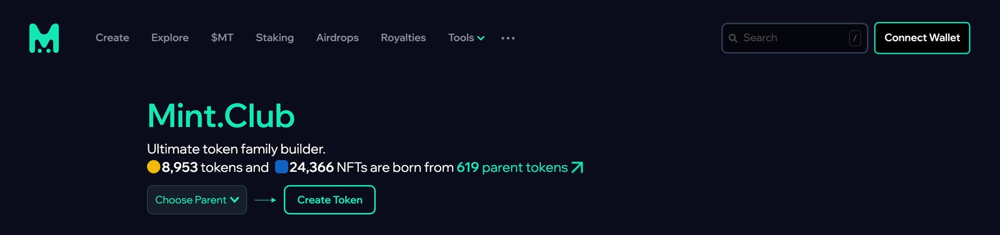
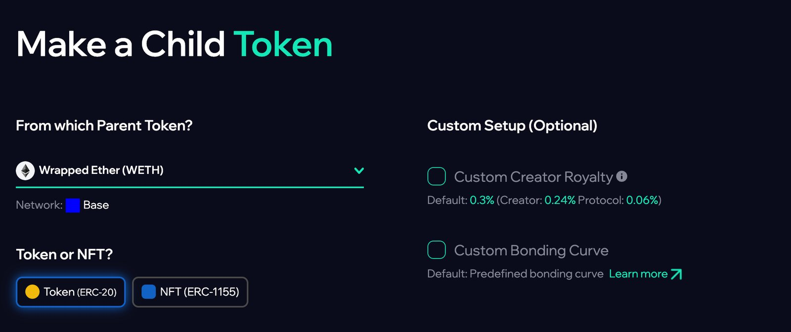

# Mint Club: Overview

**Mint Club is a no-code bonding-curve protocol** for tokens (ERC-20) and NFTs (ERC-1155).
Anyone can launch an asset on a bonding curve with no code and no liquidity pool, and it can
be bought and sold against its reserve from the start.

For Hunt Town, Mint Club is both an **active product** and the **protocol** much of the
ecosystem runs on. Co-op project tokens and legacy Mini Buildings are issued on it, and so
were many products in the [Archives](../track-record/build-log.md).

<figure><figcaption>
The Mint Club home page
</figcaption></figure>

## How a bonding curve works

- **The curve is the market.** Price is a function of supply. Buying mints new supply and
  moves the price up the curve. Selling burns supply and moves it down.
- **Every asset has its own reserve.** Buying deposits the reserve token and selling returns
  it, so a holder can always sell back to the curve. Mint Club V2 holds every reserve.
- **Creators choose the shape and the reserve.** Curves can be linear, exponential,
  logarithmic, flat and more. HUNT-backed assets use HUNT as the reserve. See
  [HUNT as the Reserve Token](../hunt/reserve-token.md).

<figure><figcaption>
Creating a child token on Mint Club
</figcaption></figure>

## Fees

Creators can set a royalty on buying and selling, paid in the reserve token, and the protocol
keeps a share of it. Launching an asset costs a small creation fee plus gas. Current rates are
in the [Mint Club docs](https://docs.mint.club).

## MT (Mint Token)

MT is Mint Club's platform token, a HUNT-backed token on Base. It replaced the older MINT
token on June 5, 2025. Platform fees are used to buy back and burn MT. Its address is in
[Contracts & Addresses](../reference/contracts.md#mint-club-v2).

## Security

Mint Club V2 was audited by CertiK in January 2024 and reviewed in a community audit in
December 2023. Reports are in
[Links & Resources](../reference/links.md#security-and-audits).

Use it at [mint.club](https://mint.club). Product docs: [docs.mint.club](https://docs.mint.club).
SDK: [sdk.mint.club](https://sdk.mint.club).
