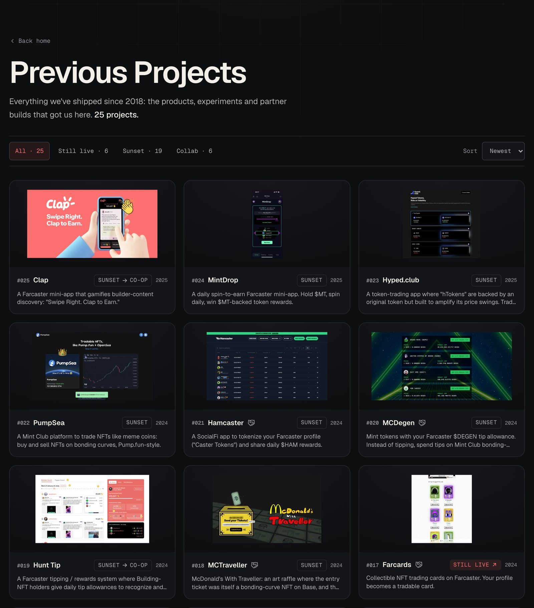

# Archives

Everything Hunt Town has shipped since 2018: **25 products**, experiments and partner builds,
newest first. Each one has its own page on [hunt.town/build-log](https://hunt.town/build-log)
with the bet, what worked, what broke and what it seeded.

**Live** = still operating · **Sunset** = retired · **→** = succeeded by a named product ·
🤝 = partner build.

<figure><figcaption>
The Archives on hunt.town
</figcaption></figure>

| # | Project | Year | Status | What it seeded |
| --- | --- | --- | --- | --- |
| 025 | [Clap](https://hunt.town/build-log/clap) | 2025 | Sunset → Co-op | Swipe-to-curate discovery, which fed the Co-op |
| 024 | [MintDrop](https://hunt.town/build-log/mintdrop) | 2025 | Sunset | A daily reward loop and the Farcaster Mini App channel for Mint Club |
| 023 | [Hyped.club](https://hunt.town/build-log/hyped-club) | 2025 | Sunset | Amplified-exposure tokens built on Mint Club curves |
| 022 | [PumpSea](https://hunt.town/build-log/pumpsea) | 2024 | Sunset | NFT trading on bonding curves, with a coin-style trading UI |
| 021 | [Hamcaster](https://hunt.town/build-log/hamcaster) 🤝 | 2024 | Sunset | A third-party SocialFi token economy on Mint Club contracts |
| 020 | [MCDegen](https://hunt.town/build-log/mcdegen) 🤝 | 2024 | Sunset | Mint Club tokens as a place to spend $DEGEN tips |
| 019 | [Hunt Tip](https://hunt.town/build-log/hunt-tip) | 2024 | Sunset → Co-op | The tipping and grants model behind Clap and the Co-op |
| 018 | [MCTraveller](https://hunt.town/build-log/mctraveller) 🤝 | 2024 | Sunset | A bonding-curve NFT used as a raffle ticket |
| 017 | [Farcards](https://hunt.town/build-log/farcards) 🤝 | 2024 | Live | Mint Club curves for social collectibles on Farcaster |
| 016 | [Memberify](https://hunt.town/build-log/memberify) 🤝 | 2024 | Sunset | Personal membership tokens built by a partner on Mint Club |
| 015 | [Town Poker](https://hunt.town/build-log/town-poker) | 2023 | Sunset | Nothing carried forward. It was a single community event |
| 014 | [Chatcasso](https://hunt.town/build-log/chatcasso) | 2022 | Sunset | The habit of building on a new capability while it is new |
| 013 | [Dixel Club V2](https://hunt.town/build-log/dixel) | 2022 | Live | Fully onchain NFTs with a refundable reserve, feeding Mint Club's NFT tools |
| 012 | [Dixel Club V1](https://hunt.town/build-log/dixel-club-v1) | 2022 | Sunset → Dixel Club V2 | The demand that became Dixel Club V2 |
| 011 | [1s.market](https://hunt.town/build-log/1s-market) 🤝 | 2021 | Sunset | The first partner product built on Mint Club |
| 010 | [Mint Club V1](https://hunt.town/build-log/mint-club-v1) | 2021 | Sunset → Mint Club V2 | Mint Club V2, the protocol Hunt Town runs today |
| 009 | [Neverlose.money](https://hunt.town/build-log/neverlose) | 2020 | Live | Lock-up and penalty mechanics, carried into Mint Club's lock-up tools |
| 008 | [Nomadtask](https://hunt.town/build-log/nomadtask) | 2020 | Sunset | The task-incentive marketplace model behind Hunt Tip and Clap |
| 007 | [Gudoks](https://hunt.town/build-log/gudoks) | 2020 | Sunset | Pay rewards only against proof that the work happened |
| 006 | [CoronaTasks](https://hunt.town/build-log/coronatasks) | 2020 | Sunset | A one-page directory format; nothing else carried forward |
| 005 | [Testfly](https://hunt.town/build-log/testfly) | 2020 | Sunset | Building a new product on a community we already had |
| 004 | [LOL Hunt](https://hunt.town/build-log/lol-hunt) | 2019 | Live | The daily curated leaderboard, applied to entertainment |
| 003 | [DRG OTC](https://hunt.town/build-log/drg-otc) | 2019 | Sunset | Build the rails others use, not a layer on someone else's |
| 002 | [Reviewhunt](https://hunt.town/build-log/reviewhunt) | 2019 | Sunset → Nomadtask | The quest ladder that Nomadtask ran on |
| 001 | [Steemhunt](https://hunt.town/build-log/steemhunt) | 2018 | Live | Hunt Town's thesis: token-rewarded curation |
